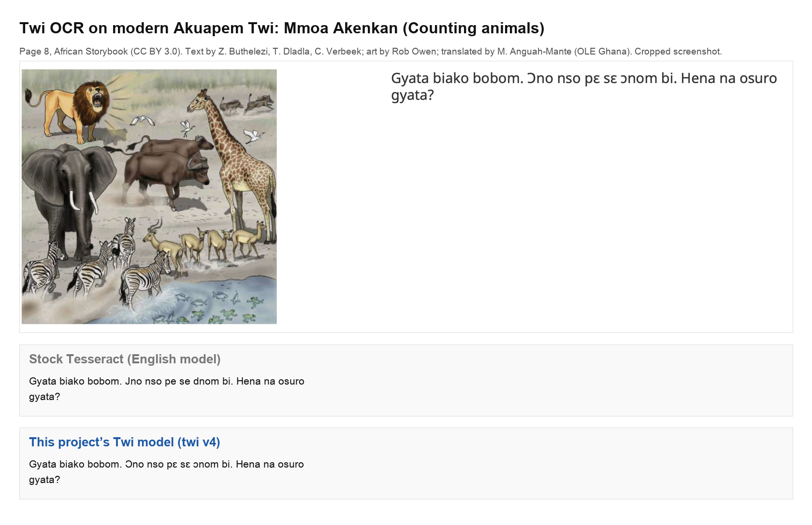
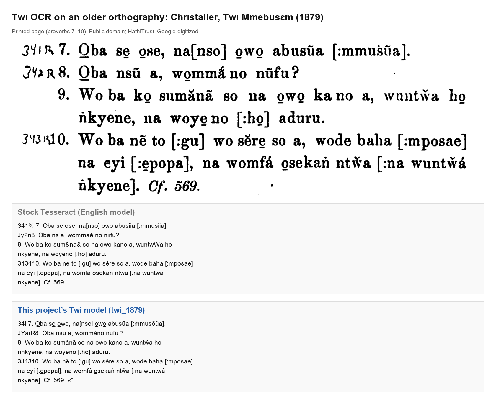

# Twi OCR: Reading Printed Akan

Two Tesseract models and a tool chain for reading printed Twi. `twi` reads modern Asante and Akuapem Twi, including the letters ɛ, ɔ, Ɛ and Ɔ that standard OCR cannot read; it is tested on scanned pages of *Bu Me Bɛ: Proverbs of the Akans*. `twi_1879` reads the older Basel Mission spelling, with its underlined vowels (e̲ o̲), tildes and accents; it is tested on J. G. Christaller's *Twi Mmebusɛm* (1879).

Akan spelling has changed since the Basel Mission first put the language into type in the 19th century. This project aims to build collaboration on identifying how Ghanaian languages are spelled and written, so that OCR can recognize them. The long-term goal is to cover many Ghanaian languages and dialects. Open questions about older spellings are GitHub issues; see [ORTHOGRAPHY.md](ORTHOGRAPHY.md) and [CONTRIBUTING.md](CONTRIBUTING.md).

The two images below show each model at work: `twi` on a page of a modern storybook, and `twi_1879` on Christaller's 1879 spelling, where e̲ and o̲ stand for ɛ and ɔ, a tilde marks a nasal vowel, a macron a long vowel, and accents mark tone.





| | Character error rate | ɛ/ɔ accuracy |
| --- | --- | --- |
| Stock Tesseract (English) | 14.6% | 0.0% |
| This project (model v4 + public post-correction) | 3.4% | 97.3% |

Full results for every model version are in [`eval/bu_me_be_results.md`](eval/bu_me_be_results.md) (Bu Me Bɛ) and [`eval/christaller_1879/results.md`](eval/christaller_1879/results.md) (1879), and a write-up of the findings for both books is in [`docs/WRITEUP.md`](docs/WRITEUP.md).

## Quick start

1. Install [Tesseract 5](https://tesseract-ocr.github.io/tessdoc/Installation.html) (macOS: `brew install tesseract`) and the Python packages: `pip install -r requirements.txt`
2. Download `twi.traineddata` from the [latest release](https://github.com/ashantiowusu-brafi/twi-ocr/releases) or [Hugging Face](https://huggingface.co/ashantiowusu-brafi/twi-ocr) into `models/`.
3. Optional, for i/l correction: `python download.py` (fetches the GhanaNLP word list).
4. Run it:

```
python ocr.py page.png                 # print the text
python ocr.py book.pdf --out text/     # one .txt per page
python ocr.py scans/ --out text/       # a whole folder
```

**Limitations:** each model was tested on one book (`twi` on *Bu Me Bɛ*, `twi_1879` on Christaller's 1879 book); it reproduces spelling as printed and does not modernize it; tone marks were not tested; the model is for non-commercial use (CC BY-NC-SA 4.0). The `twi` model has so far been scored on proverbs 1–320 of *Bu Me Bɛ*; it will be scored on the whole book once all 7,015 proverbs are transcribed and reviewed as an answer key. See [docs/WRITEUP.md](docs/WRITEUP.md) for next steps, and [CONTRIBUTING.md](CONTRIBUTING.md) and [ORTHOGRAPHY.md](ORTHOGRAPHY.md) for how to help.

## Older books (1879 spelling) and how to help

Books from the Basel Mission era, such as J. G. Christaller's *Twi Mmebusɛm* (1879), wrote ɛ and ɔ as e̲ and o̲ and used tildes and accents that modern Twi doesn't use. A separate model, `twi_1879`, reads them:

```
python ocr.py christaller.pdf --orthography 1879 --out text/
# page.txt         exactly as printed (e̲ o̲ ã á ṅ ...)
# page.modern.txt  converted to modern spelling (ɛ ɔ, no accents)
```

On four proofread pages of the 1879 book (proverbs 1–96):

| | Character error rate | Error rate after converting to modern spelling | 1879 marks read correctly |
| --- | --- | --- | --- |
| Stock Tesseract (English) | 13.5% | 10.1% | 3% |
| `twi` (v4, modern model) | 11.8% | 9.3% | 18% |
| `twi_1879` + clean-up | 5.1% | 4.0% | 80% |

It reads the underlined vowels correctly 88% of the time. The weakest marks are ṅ and w̌. A second training run read more of the ṅ and w̌ marks but lost underlines, so it was not released. Details: [`eval/christaller_1879/`](eval/christaller_1879/).

### Each model on each book

| Model | *Bu Me Bɛ* (modern): error rate | *Bu Me Bɛ*: ɛ/ɔ read correctly | 1879 book: error rate, as printed | 1879 book: marks kept |
| --- | --- | --- | --- | --- |
| Stock Tesseract (English) | 14.6% | 0% | 13.5% | 3% |
| `twi` (v4, modern model) | 4.1% | 97% | 11.8% | 18% |
| `twi_1879` (1879 model) | 12.8% | 37% | 6.1% (5.1% with clean-up) | 80% |

Each model works only on the spelling it was trained for. `twi_1879` was trained to write ɛ and ɔ as e̲ and o̲, so on modern text it scores close to stock Tesseract; `twi` drops most of the 1879 marks. Scores on *Bu Me Bɛ* are for 319 proverbs; on the 1879 book, for the four proofread pages.

The book's own key to the letters explains most of the marks: line below = open vowel (ɛ ɔ), tilde = nasal, macron = long, breve = very short, acute and grave = tone, ṅ = ng. A few questions remain, such as the exact mark over w and how the spelling changed between books. **[ORTHOGRAPHY.md](ORTHOGRAPHY.md)** lists what is known and the open questions. You can help with no coding at all, by citing a page from an old book or transcribing one. See **[CONTRIBUTING.md](CONTRIBUTING.md)**.

## How it works


1. **Text:** Twi sentences are collected from GhanaNLP and the Ghana Corpus, cleaned, and standardized (for example, Greek ε is replaced with Twi ɛ).
2. **Training images:** the text is rendered as scan-like line images in fonts that contain ɛ and ɔ, styled after the book (capitals, proverb numbers, curly quotes).
3. **Training:** Tesseract's Latin model is fine-tuned on those images with tesstrain, following the method of the Ewe Tesseract model.
4. **Post-correction:** a Twi word list fixes the model's main remaining mistake, i read as l. No other letters are changed, because e/ɛ and o/ɔ distinguish words in Twi.
5. **Evaluation:** every model is scored on the same proverbs against a typed, proofread answer key.

## Scripts

| Script | Purpose |
| --- | --- |
| `ocr.py` | **Read images or PDFs with the model (start here)** |
| `app/twi_ocr_app.py` | Desktop app for Mac: the same reading in a window (see `app/README.md`) |
| `download.py` | Download and clean the GhanaNLP and Ghana Corpus text |
| `prepare_ug.py` | Extract UGSpeechData transcriptions for the private word list |
| `render_lines.py` | Render training line images |
| `pdf_to_png.py` | Convert scanned PDFs to page images |
| `compare_models.py` | Score every model on the same proverbs; writes `eval/bu_me_be_results.md` |
| `error_report.py` | Report a model's remaining errors; writes `eval/errors_<model>.md` |
| `postcorrect.py` | i/l word-list correction (`--public` uses GhanaNLP text only) |
| `orthography.py` | Convert between 1879 and modern spelling (rules in `orthography/christaller_1879.tsv`) |
| `render_lines.py --orthography 1879` | Render 1879-style training lines |
| `scripts/train_1879.sh` | Fine-tune `twi_1879` from the best modern model |
| `score_1879.py` | Score models on transcribed 1879 pages; writes `eval/christaller_1879/results.md` |
| `scripts/create_issues.sh` | Open the orthography questions as GitHub issues |
| `tools/answer_key/` (`review_letters.py`, `spelling_review.py`, `fix_key_quotes.py`) | Answer-key review tools |

Training uses [tesstrain](https://github.com/tesseract-ocr/tesstrain):

```
gmake training MODEL_NAME=twi START_MODEL=Latin TESSDATA=$PWD/tessdata_best \
  GROUND_TRUTH_DIR=../private/ground-truth MAX_ITERATIONS=10000 PY_CMD=$VIRTUAL_ENV/bin/python
```

## Setup

- Python 3.12 (tested with 3.12.2) and `pip install -r requirements.txt`, which installs the exact package versions used for the published results
- Tesseract 5.5 with training tools (tested with 5.5.4), and GNU make 4.2+ (`gmake`)
- `Latin.traineddata` from [tessdata_best](https://github.com/tesseract-ocr/tessdata_best)
- Fonts with ɛ and ɔ, placed in `fonts/`: [Charis SIL](https://software.sil.org/charis/) and [Noto Serif](https://fonts.google.com/noto/specimen/Noto+Serif)

## What is not in this repository

The `private/` folder is excluded from this version. It holds material that cannot be republished: scans and the typed text of *Bu Me Bɛ* (in copyright), the Ghana Corpus Bible text and images rendered from it, and UGSpeechData transcriptions (no redistribution of modified versions).

## Data and credits

### Data

- **GhanaNLP Parallel Corpora** (training text and public word list). Base license CC BY-NC-SA 4.0, plus GhanaNLP's terms (paper, section 6): derivative works must use the same license; commercial use needs written permission and a separate paid license; no military use; original metadata and source attribution must be kept; cultural or dialectal references may not be removed. Contact: team@ghananlp.org. The paper notes that the Twi set includes culturally protected proverbs. Adu Gyamfi, Lawrence, Paul Azunre, Stephen Edward Moore, Joel Budu, Akwasi Asare, Mich-Seth Owusu, and Jonathan Ofori Asiamah. "GhanaNLP Parallel Corpora: Comprehensive Multilingual Resources for Low-Resource Ghanaian Languages." arXiv:2603.13793v2, 2026. https://arxiv.org/abs/2603.13793v2. Datasets: https://huggingface.co/datasets/Ghana-NLP/TWI_ENGLISH_PARALLEL_TEXT and https://huggingface.co/datasets/Ghana-NLP/ENGLISH_TWI_PARALLEL_TEXT.
- **Ghana Corpus** (training text and private word list). CC BY-NC 4.0, for non-commercial research and education with attribution. The text comes from Bible translations (Asante Twi versions 1461, 1861, 2094; Akuapem Twi versions 1631, 3439, 3440, YouVersion IDs), whose rights belong to their publishers. Ghana NLP Community. "Ghana Corpus." Hugging Face. https://huggingface.co/datasets/ghananlpcommunity/ghana-corpus. Downloaded with: Ghana NLP Community. "Ghana Corpus Builder." MIT License. https://github.com/GhanaNLP/ghana-corpus-builder.
- **UGSpeechData** (private word list only). CC BY-NC-ND 4.0. Wiafe, I., J.-D. Abdulai, A. O. Ekpezu, R. D. Helegah, E. D. Atsakpo, C. Nutrokpor, F. B. P. Winful, and K. K. Solaga. "Advancing Automatic Speech Recognition for Low-Resource Ghanaian Languages: Audio Datasets for Akan, Ewe, Dagbani, Dagaare, and Ikposo." *Data in Brief* 61 (2025): 111880. Data: https://doi.org/10.57760/sciencedb.22298.
- **1879 test set:** J. G. Christaller, *Twi Mmebusɛm* (Basel, 1879), public domain; see `sources/christaller_1879/SOURCE.md`.
- **Modern demo image:** *Mmoa Akenkan* (*Counting animals*), Akuapem Twi, [African Storybook](https://global-asp.github.io/storybooks-ghana/stories/tw-akua/0327/): text by Zanele Buthelezi, Thembani Dladla and Clare Verbeek; illustrations by Rob Owen; translated by Michael Anguah-Mante (OLE Ghana). CC BY 3.0; see `docs/demo/SOURCE.md`.
- **Test set:** scanned pages of Appiah, Peggy, Kwame Anthony Appiah, and Ivor Agyeman-Duah. *Bu Me Bɛ: Proverbs of the Akans*. Ayebia Clarke Publishing, 2007. Used for evaluation only; not redistributed.

### Software and methods

- Smith, Ray. "An Overview of the Tesseract OCR Engine." In *Proceedings of the Ninth International Conference on Document Analysis and Recognition (ICDAR 2007)*, 629–33. IEEE, 2007. Tesseract is Apache-2.0.
- tesseract-ocr. *tessdata_best* (`Latin.traineddata`, the base model). Apache-2.0. https://github.com/tesseract-ocr/tessdata_best.
- tesseract-ocr. *tesstrain*. Apache-2.0. https://github.com/tesseract-ocr/tesstrain.
- Method followed: NissiKlaus. "Ewe Tesseract OCR," v0.1.0. Hugging Face. https://huggingface.co/NissiKlaus/ewe-tesseract-ocr. (Method only; no files from that repository are used.)
- Fonts used to render training images: SIL International, *Charis SIL*; Google, *Noto Serif*. Both SIL Open Font License 1.1.
- Python libraries and their licenses: see [`THIRD_PARTY_NOTICES.md`](THIRD_PARTY_NOTICES.md).

### Acknowledgements

This project was hosted by the Si Hene Foundation. Nana Adwoa Agyekum helped transcribe the *Bu Me Bɛ* proverbs used as the answer key for testing the `twi` model.

### Development

Code was developed with assistance from Claude (Anthropic). Design decisions, answer-key proofreading, scan verification and review of all results are by the author.

## License

- Code: MIT License (see `LICENSE`).
- Documentation, the orthography rules and transcriptions: CC BY 4.0.
- Model (`models/*.traineddata`): CC BY-NC-SA 4.0, non-commercial, because it was trained on GhanaNLP and Ghana Corpus text. See [`models/README.md`](models/README.md).

To cite this project, see [`CITATION.cff`](CITATION.cff).
